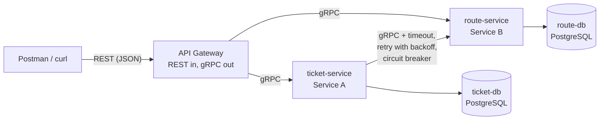

# Bus Booking: Two Collaborating Microservices

WEB303 Microservices & Serverless Applications, Programming Assignment 1.

A small bus-ticketing system built from two Go microservices that talk to each other over gRPC, behind a REST API gateway. Each service owns its own PostgreSQL database. The whole system starts with one command: `docker compose up`.

| Role | Service | Owns | Database |
|---|---|---|---|
| Service B (independent) | `route-service` | Bus routes | `route-db` |
| Service A (dependent) | `ticket-service` | Tickets that reference a route | `ticket-db` |
| Entry point | `gateway` | Nothing (REST to gRPC translation) | none |

A ticket can only exist for a route that exists. Before saving a ticket, `ticket-service` calls `route-service` over gRPC to confirm the route, check its seat capacity and read its price (`total_price = seats x route price`).

## Architecture



- Postman only ever calls the gateway.
- Each service reads and writes **only its own database**. `tickets.route_id` is a plain column with no foreign key, because the `routes` table lives in another service's database. `ticket-service` learns about routes only through `route-service`'s gRPC API.
- Only the gateway publishes a port to the host. The services and databases are reachable only on the internal Compose network.

## Quick start

**Prerequisites:** Docker with Compose v2. (To run the test scripts you also need `bash` and `curl`.)

```bash
git clone https://github.com/namgaylhamo24/busbooking.git
cd busbooking
cp .env.example .env        # optional: every value has a default
docker compose up --build
```

The gateway is then available at **http://localhost:8080** (change the host port with `GATEWAY_PORT` in `.env`).

```bash
curl http://localhost:8080/health          # {"status":"ok"}
docker compose ps                          # 5 containers: 2 databases, 2 services, gateway
```

Stop and delete everything, including the data volumes:

```bash
docker compose down -v
```

## REST API (gateway)

| Method | Path | gRPC call | Success | Error codes |
|---|---|---|---|---|
| GET | `/health` | none | 200 | |
| POST | `/routes` | `RouteService.CreateRoute` | 201 | 400 |
| GET | `/routes` | `RouteService.ListRoutes` | 200 | |
| GET | `/routes/{id}` | `RouteService.GetRoute` | 200 | 400, 404 |
| PUT | `/routes/{id}` | `RouteService.UpdateRoute` | 200 | 400, 404 |
| DELETE | `/routes/{id}` | `RouteService.DeleteRoute` | 204 | 400, 404 |
| POST | `/tickets` | `TicketService.CreateTicket` | 201 | 400, 404, 503 |
| GET | `/tickets` | `TicketService.ListTickets` | 200 | |
| GET | `/tickets/{id}` | `TicketService.GetTicket` | 200 | 400, 404 |
| PUT | `/tickets/{id}` | `TicketService.UpdateTicket` | 200 | 400, 404, 503 |
| DELETE | `/tickets/{id}` | `TicketService.DeleteTicket` | 204 | 400, 404 |

Example:

```bash
# create a route
curl -X POST localhost:8080/routes -H 'Content-Type: application/json' \
  -d '{"origin":"Thimphu","destination":"Phuntsholing","departure_time":"08:30","price":350,"total_seats":30}'

# book 2 seats (use the route id returned above)
curl -X POST localhost:8080/tickets -H 'Content-Type: application/json' \
  -d '{"route_id":"<ROUTE_ID>","passenger_name":"Karma Dorji","travel_date":"2026-12-01","seats":2}'
```

### gRPC to HTTP error mapping

Errors are returned as `{"error": "<message>", "grpc_code": "<Code>"}`.

| gRPC code | HTTP status |
|---|---|
| `InvalidArgument` | 400 Bad Request |
| `NotFound` | 404 Not Found |
| `AlreadyExists` | 409 Conflict |
| `Unavailable` | 503 Service Unavailable |
| `DeadlineExceeded` | 504 Gateway Timeout |
| anything else | 500 Internal Server Error (details are logged, not returned) |

The gateway itself returns 400 for malformed JSON, an empty body or unknown fields, and 404 for unknown endpoints.

## Validation

Validation lives in the services (the source of truth) and runs **before** any database write, so invalid data is never stored.

**Route** (`route-service`)

| Field | Rule |
|---|---|
| `origin`, `destination` | required, 2-60 characters, must differ (case-insensitive) |
| `departure_time` | `HH:MM`, 24-hour |
| `price` | greater than 0 |
| `total_seats` | 1 to 100 |
| `id` (in URLs) | valid UUID |

**Ticket** (`ticket-service`)

| Field | Rule |
|---|---|
| `route_id` | required, valid UUID, must exist in route-service |
| `passenger_name` | required, 2-80 characters |
| `travel_date` | `YYYY-MM-DD`, a real date, not in the past |
| `seats` | at least 1, and not more than the route's `total_seats` |
| `total_price` | computed by the service (client values are ignored) |

## Resilience (ticket-service to route-service)

Every call from `ticket-service` to `route-service` goes through `ticket-service/routeclient.go`:

| Pattern | Behaviour | Default | Env var |
|---|---|---|---|
| Timeout | Each attempt has its own deadline | 2000 ms | `ROUTE_TIMEOUT_MS` |
| Retry with backoff | Retries `Unavailable` and `DeadlineExceeded`; wait doubles each time (200 ms, 400 ms) | 3 attempts, 200 ms base | `ROUTE_MAX_ATTEMPTS`, `ROUTE_BACKOFF_MS` |
| Circuit breaker | Opens after consecutive failed calls; rejects instantly while open; then lets one probe through (half-open) | 3 failures, 10 s open | `CB_FAILURE_THRESHOLD`, `CB_OPEN_SECONDS` |

- `NotFound` and `InvalidArgument` are real answers from a healthy service, so they are **not retried** and **do not count** towards opening the breaker.
- **When route-service is down:** creating or updating a ticket returns `503` with a clear message ("route service is unreachable..." or "circuit breaker open"). It never hangs, and nothing is stored.
- **Fallback:** reading a ticket still works. The ticket is returned from its own database with `"degraded": true` and no route details.
- Stopping `ticket-service` does not affect `/routes` (fault isolation).

Try it:

```bash
./scripts/resilience-demo.sh http://localhost:8080
# or by hand:
docker compose stop route-service     # then POST /tickets a few times
docker compose logs -f ticket-service # watch retries and breaker transitions
docker compose start route-service    # wait ~12 s, then the breaker recovers
```

## Configuration (environment variables)

Nothing is hard-coded. `.env.example` lists the values read by Compose; every one has a default.

| Variable | Used by | Default | Purpose |
|---|---|---|---|
| `GATEWAY_PORT` | compose | 8080 | host port the gateway is published on |
| `GATEWAY_TIMEOUT_MS` | gateway | 10000 | per-request deadline for backend calls |
| `ROUTE_DB_USER` / `_PASSWORD` / `_NAME` | route-db, route-service | route_user / route_pass / route_db | route database credentials |
| `TICKET_DB_USER` / `_PASSWORD` / `_NAME` | ticket-db, ticket-service | ticket_user / ticket_pass / ticket_db | ticket database credentials |
| `ROUTE_TIMEOUT_MS`, `ROUTE_MAX_ATTEMPTS`, `ROUTE_BACKOFF_MS` | ticket-service | 2000 / 3 / 200 | retry and timeout settings |
| `CB_FAILURE_THRESHOLD`, `CB_OPEN_SECONDS` | ticket-service | 3 / 10 | circuit breaker settings |

Set inside the containers by `docker-compose.yml`: `GRPC_PORT`, `HTTP_PORT`, `DB_HOST`, `DB_PORT`, `DB_USER`, `DB_PASSWORD`, `DB_NAME`, `ROUTE_SERVICE_ADDR`, `TICKET_SERVICE_ADDR`.

## Testing

| What | How |
|---|---|
| Postman | Import `postman_collection.json`. Set the `baseUrl` variable to your gateway URL. Run folders 0 to 4 with the Collection Runner; folder 5 (resilience) is manual. |
| Smoke test (22 requests, prints expected vs actual status) | `./scripts/smoke-test.sh http://localhost:8080` |
| Resilience demo | `./scripts/resilience-demo.sh http://localhost:8080` |

## Project structure

```
busbooking/
  proto/
    route/v1/route.proto        RouteService (CRUD)
    ticket/v1/ticket.proto      TicketService (CRUD)
  gen/                          generated Go code (committed so Docker builds work)
  route-service/                Service B: main.go, server.go, store.go, validate.go, Dockerfile
  ticket-service/               Service A: main.go, server.go, store.go, validate.go, routeclient.go, Dockerfile
  gateway/                      REST to gRPC: main.go, handlers.go, respond.go, middleware.go, Dockerfile
  scripts/                      smoke-test.sh, resilience-demo.sh
  docker-compose.yml
  .env.example
  postman_collection.json
  README.md
```

Each service folder has a multi-stage `Dockerfile`: a Go build stage, then a minimal Alpine runtime image running as a non-root user.

Regenerate the gRPC code after editing a `.proto` file (needs `protoc`, `protoc-gen-go`, `protoc-gen-go-grpc`):

```bash
protoc --go_out=. --go_opt=module=busbooking \
       --go-grpc_out=. --go-grpc_opt=module=busbooking \
       proto/route/v1/route.proto proto/ticket/v1/ticket.proto
```

## Design notes and limitations

- **Why `ticket-service` stores `total_price`:** it is the price at booking time, so later route price changes don't rewrite history.
- **Deleting a route** does not delete its tickets (that would need cross-service coordination). Such tickets are still returned, flagged `degraded: true` with `route_summary: "route no longer exists"`.
- **Seat capacity** is checked per booking against the route's `total_seats`. Tracking seats already sold per travel date is out of scope.
- gRPC traffic is plaintext inside the private Compose network; there is no authentication.
